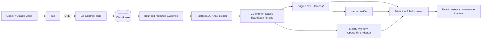

# Catena

Go + Agent 工程平台：**Trace → Evidence → Analysis Job → Artifact → Evaluation / Review**。

Tap 采集 Codex / Claude Code 的 Turn/工具事件并上传 OTLP，Go 负责认证、Agent 身份、ClickHouse Trace、PostgreSQL 任务和 Artifact。Python Engine 提供两条平级、可替换的产物 Pipeline：RSI（Harness²）与 Memory（OpenViking）。Harbor 是独立验证执行器，候选默认 unverified，不自动采用、合并或发布。



- 一套 Go 持久队列：重试、超时、取消、租约恢复、fencing，默认单 Worker。
- RSI 基于 Trace/Agent 时间窗和管理员注册的 Harbor Case，保存 Candidate 文件、父版本、内容哈希、Trial/预算与验证来源。支持已有 Adapter 组合；HarnessPro 尚未实现。
- Memory 可独立从 Trace、Agent Trace 集或历史 Session 提炼；Go 确定 owner，Engine 对接 OpenViking。保存 provider task checkpoint，重试恢复查询；Artifact 为 extracted，不能当成已确认事实。
- Trace 写入保留背压、身份隔离、脱敏 Evidence；模型密钥按 owner 加密，提供方 Memory 密钥仅在 Engine。
- 已移除固定三 Role、SDK 回退、Barena Runner/Replay/Release 自动晋级及 GauzMem 部署。认证表的历史 barena_* 名称与原队列表名为数据兼容保留。

## 使用与验证

- [部署指南](deploy/catena-mvp1/README.md)：默认四服务，RSI / OpenViking 分别显式启用。
- [当前规格](SPEC.md)、[RSI 约定](docs/RSI_ADAPTERS.md)、[OpenViking 迁移](docs/OPENVIKING_INTEGRATION.md)。
- [V2 重构报告与验收证据](docs/refactors/CATENA_V2.md)。测试通过不等于真实模型或生产部署验收通过。

```sh
cd control-plane && go test ./... && go vet ./...
# 独立 Python 3.12 环境
cd ../engine && pip install -e '.[dev,rsi]' && pytest
cd ../catena-web && pnpm install --frozen-lockfile --ignore-workspace && pnpm test && pnpm build
```

数据库集成测试使用 `BARENA_TEST_DATABASE_URL` 和 `CATENA_CLICKHOUSE_TEST_DSN`；跨进程 fixture 测试另设 `CATENA_ENGINE_TEST_PYTHON` 为已安装 Engine 的 Python 路径。集成测试只使用隔离 schema 和合成内容。

## 保留的研究证据

历史实验不作为 V2 实测结果：[rg-missing-search Case](evals/rg-missing-search/CASE.md)、[案例结论](docs/CASE_RG_MISSING_20261003.md)、[冻结 168 Rollouts 报告](evals/trace-skill-benchmark/results/ab-v2.md)。冻结实验 without/with 为 77/84 与 80/84，总 token 增加 9.1%，不支持总体成本下降或广泛有效的结论。任务不是严格历史 held-out 集。

私人 Transcript、模型密钥与敏感 Trace 不纳入公开仓库。历史规格见 [V1 archive](docs/archive/v1/SPEC.md)，历史专用 Engine 源码见 [research](research/legacy-engine/README.md)；它们不是现行运行路径。
