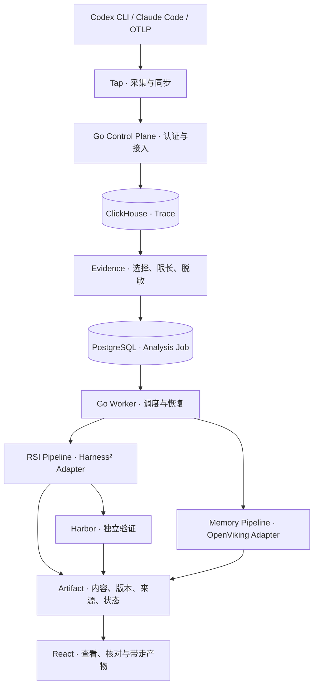

<p align="center">
  
</p>

<h1 align="center">Catena</h1>

<p align="center"><strong>Agent 长期记忆与工作进化平台</strong></p>
<p align="center">从运行经历中沉淀工程记忆，用可复现的实验检验改进。</p>

<p align="center">
  <a href="https://github.com/fightheyyy/CATENA/actions/workflows/catena-mvp1-ci.yml"></a>
  <a href="control-plane/go.mod"></a>
  <a href="engine/pyproject.toml"></a>
  <a href="LICENSE.md"></a>
</p>

<p align="center">
  <a href="#快速开始">快速开始</a> ·
  <a href="#工作方式">工作方式</a> ·
  <a href="#实验与验证">实验与验证</a> ·
  <a href="#文档导航">文档</a>
</p>

## 为什么做 Catena

一次 Agent 任务结束后，值得保留的东西往往散在对话、工具输出和临时修改里：哪些做法有效、哪些错误反复发生、一个 Skill 到底改善了什么。下次换个 Session 或换个 Agent，这些经验又需要重新整理。

Catena 将这些经历接入同一条工作流：回看原始执行证据，提炼可复用的工程记忆，生成带来源的改进候选，再通过独立评测，由开发者决定是否采用。长期目标是让这些经验成为团队持续积累的工作记忆。

## 能做什么

| 能力 | 使用方式 | 留下的结果 |
|---|---|---|
| **回看经历** | 通过 Tap 接入 Codex CLI、Claude Code，或直接上传 OTLP Trace | Turn、工具调用、错误状态和来源上下文 |
| **提炼记忆** | 从 Trace、Agent 时间窗或历史 Session 独立发起 Memory 分析，对接 OpenViking | 工程记忆产物及其来源、提炼状态 |
| **生成改进候选** | RSI Adapter 消费 Evidence，目前接入 Harness² | `AGENTS.md`、Skill 文件，以及候选版本和父版本关系 |
| **检验改动** | 在已注册的 Harbor Case 上比较 Baseline / Candidate | 独立 Verifier 结果、工具调用、Token、耗时与实验来源 |

记忆提炼和候选生成可以分别启用。界面可以查看任务状态、回到来源 Trace、阅读产物，并复制或下载候选文件。

## 工作方式

```text
Agent 经历 → Trace → Evidence → Analysis Job → Artifact → Evaluation / Review
```



**Go 管任务和数据，Python 管分析和提供方接入。** 两条 Pipeline 共用 Go 持久队列，Harbor 负责验证执行。算法、记忆提供方和执行传输分别放在 Adapter 边界中；当前实现是 Harness²、OpenViking 和 Codex CLI，后续算法可以沿用现有契约接入。

工程底座保留了几项关键约束：

- **先写入，再确认接收。** OTLP 接入有并发限制与背压，ClickHouse 写入成功后才确认；Tap 使用稳定 Span ID 和上传记录恢复重试。
- **任务状态可恢复。** PostgreSQL 保存任务，Worker 使用 Lease、Heartbeat 和 Fencing Token，支持重试、超时、取消及过期接管。
- **重试考虑外部成本。** Engine 持久化执行回执，Memory 保存提供方任务检查点；崩溃后状态不确定的外部执行需要人工核查。
- **结论带着证据走。** Artifact 关联来源与验证状态。候选在验证前保持 `unverified`，记忆的 `extracted` 状态保留人工确认的空间。

## 快速开始

基础服务需要 **Linux、Docker Engine 和 Docker Compose v2**。通过 Compose 启动时，本机无需另装 Go、Node 或 Python。

### 1. 启动基础服务

```bash
git clone https://github.com/fightheyyy/CATENA.git
cd CATENA
cp deploy/catena-mvp1/.env.example deploy/catena-mvp1/.env
```

编辑 `.env`，替换密钥和数据库密码，并让 `CATENA_CLICKHOUSE_DSN` 中的密码与 `CATENA_CLICKHOUSE_PASSWORD` 保持一致，然后启动：

```bash
./deploy/catena-mvp1/demo.sh up
```

打开 **http://localhost:5570**。启动脚本会构建服务、等待健康检查并执行 Smoke Test。

默认运行四个服务：Go + React、Python Engine、PostgreSQL、ClickHouse。Web 监听本机回环地址，Engine 使用私有服务鉴权。

```bash
./deploy/catena-mvp1/demo.sh logs    # 查看服务日志
./deploy/catena-mvp1/demo.sh down    # 停止服务，保留数据卷
```

### 2. 接入第一个 Agent

在界面的 **连接** 页面注册 Agent、创建专属 API Key，按照页面给出的配置安装采集插件。Tap 在 Turn 结束后增量同步运行证据；也支持导入本地历史记录。

已有 JSONL 可以先在本机解析查看，再明确选择上传：

```bash
python3.12 -m pip install -e ./tap
catena trace import codex /path/to/rollout.jsonl
catena trace import claude /path/to/transcript.jsonl
```

插件安装、上传配置和已验证的 Runtime 版本见 [Tap 接入指南](tap/README.md)。

### 3. 启用需要的分析能力

| 目标 | 需要配置 | 指南 |
|---|---|---|
| 查看与检索 Trace | 基础四服务 + Agent 接入 | [部署](deploy/catena-mvp1/README.md) |
| 提炼工程记忆 | OpenViking 服务、提供方模型/Embedding 配置及 Memory overlay | [OpenViking](docs/OPENVIKING_INTEGRATION.md) |
| 生成并评测候选 | 用户自己的分析模型、已注册的 Harbor Case 及 RSI overlay | [RSI / Harness²](docs/RSI_ADAPTERS.md) |

RSI 使用用户在连接页面保存的模型配置，通过 Codex CLI 调用 Responses-compatible 服务。Memory 使用独立的提供方配置。启动基础服务后，可先完成 Trace 接入，再选择启用哪条分析路径。

Harbor 的 Docker 访问需要显式配置，Case 由部署者审核注册。完整配置、持久卷、备份和公网部署方式见 [部署指南](deploy/catena-mvp1/README.md)。

## 实验与验证

Catena 同时保留系统工程验收和 Agent 改进实验，分别记录它们能够支持的结论。

**V2 工程验收**已覆盖 Go 单元与数据库 Race Test、跨进程 Go → Python → PostgreSQL 协议、Engine 干净依赖安装、前端浏览器流程，以及 Engine 镜像构建和鉴权检查。具体命令、原始结果与未验证项见 [V2 验收报告](docs/refactors/CATENA_V2.md)。

**历史 Skill A/B 实验**从审计过的 Trace 中归纳 7 项手工 Skill，构造 28 个匿名重建与变体任务，通过 Harbor 驱动 Codex CLI 完成 168 次有效对照：

| 指标 | Without Skill | With Skill |
|---|---:|---:|
| Verifier 通过 | 77 / 84 | 80 / 84 |
| 工具调用 | 660 | 796 |
| 同类错误次数 | 23 | 27 |

观察到的通过率增加伴随着工具调用、同类错误和总 Token 的增加（Token **+9.1%**）。这组实验未证明普遍改善或成本下降，任务也不属于严格的历史 held-out 集。

[完整指标与限制](evals/trace-skill-benchmark/results/ab-v2.md) · [任务集与复跑说明](evals/trace-skill-benchmark/README.md) · [首个真实问题：缺失 rg](docs/CASE_RG_MISSING_20261003.md)

### 当前状态

V2 已完成架构收敛。当前按 owner 隔离数据；组织成员管理与团队共享权限尚未实现。HarnessPro 等其他 RSI 算法尚未接入。

**V2 的真实模型 Harness² → Harbor 闭环，以及真实 OpenViking 提炼验收仍待完成。** 历史实验结果和协议 Fixture 各有适用范围，当前也没有目标生产服务器容量结论。团队工作记忆和长期改进效果将继续依靠后续实验验证。

## 开发

开发环境：Go 1.25、Python 3.12、Node.js 24、pnpm 10.24。

```bash
# Go 控制面
(cd control-plane && go test ./... && go vet ./...)

# Python Engine：建议使用独立虚拟环境
python3.12 -m venv .venv
.venv/bin/python -m pip install -e 'engine[dev,rsi]'
(cd engine && ../.venv/bin/python -m pytest)

# React 前端
(cd catena-web && pnpm install --frozen-lockfile --ignore-workspace && pnpm test && pnpm build)
```

PostgreSQL / ClickHouse 集成测试、浏览器测试及跨进程 Fixture 的配置见 [验收命令](docs/refactors/evidence/v2/COMMANDS.md)。

```text
control-plane/   Go API、认证、Trace 接入、任务队列与 Artifact 持久化
engine/          RSI / Memory Pipeline、Codex 传输与 Harbor 验证适配
catena-web/      Trace、任务、记忆与产物界面
tap/             Codex / Claude Code 采集插件与历史导入
evals/           可复跑 Case、Verifier 与冻结实验材料
deploy/          Docker Compose 与部署脚本
docs/            规格、研究、部署与验收记录
```

## 文档导航

| 文档 | 内容 |
|---|---|
| [当前规格](SPEC.md) | 产品定位、系统职责与实现范围 |
| [部署指南](deploy/catena-mvp1/README.md) | 基础服务、可选 Pipeline、持久化与迁移 |
| [Tap 接入](tap/README.md) | 采集插件、支持版本与历史导入 |
| [RSI Adapter](docs/RSI_ADAPTERS.md) | Harness²、Case 注册、预算与验证契约 |
| [Memory Adapter](docs/OPENVIKING_INTEGRATION.md) | OpenViking、owner 隔离与异步提炼 |
| [Engine Runtime](docs/CODEX_ENGINE_RUNTIME.md) | Codex CLI 隔离、超时、取消与执行回执 |
| [V2 工程验收](docs/refactors/CATENA_V2.md) | 测试证据、数据兼容与剩余风险 |

## 许可与致谢

Catena 使用 [Apache License 2.0](LICENSE.md)。

感谢 [Harness²](https://github.com/google-research/harness2)、[OpenViking](https://github.com/volcengine/OpenViking) 和 [Harbor](https://github.com/harbor-framework/harbor) 提供的开源基础。Tap 的部分解析器源自 Langfuse 开源插件，来源与许可证见 [第三方声明](tap/THIRD_PARTY_NOTICES.md)。
