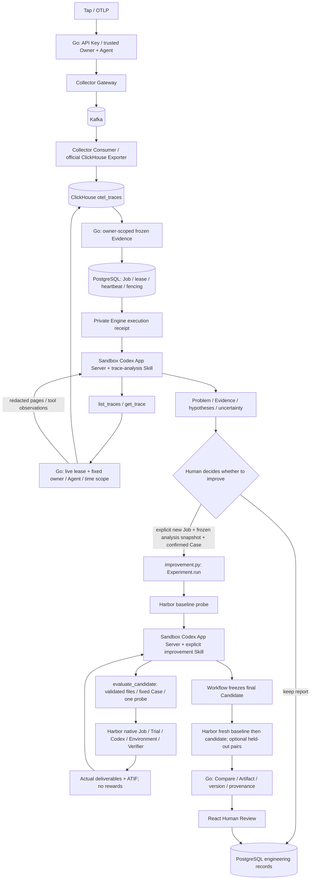

# CATENA architecture

用户托管执行的实际三层架构、状态机、关键表及边界见 [Managed Infrastructure](MANAGED_INFRASTRUCTURE.md)。Go 负责调度与鉴权，私有 SDK adapter 调用 OpenSandbox。Analysis、Improvement 和 Managed 的 Codex App Server 均在 Sandbox 内执行，业务工作流与 Harbor 评测仍独立。参见[重构前后架构、所有权与迁移](refactors/UNIFIED_HARNESS.md)。

Codex = Analysis / Improvement / Managed Agent Runtime. Harbor = evaluation engine.
CATENA = attribution, orchestration and engineering records.

| Source | Responsibility |
|---|---|
| `backend/internal/control/analysis_job.go` | Evidence, Job admission, private invocation, persisted result/artifacts |
| `backend/internal/control/trace_investigation.go` | Task-scoped read-only Trace tools, active-lease authorization, pagination and redaction |
| `analysis_worker.go`, `postgres_analysis_queue.go` | Durable scheduling, retry/cancel/timeout, lease and fencing |
| `review.go`, `artifact.go` | Independent Compare eligibility, immutable review, owner-scoped history |
| `engine/catena_engine/analysis.py`, `skills/trace-analysis/SKILL.md` | Analysis-only report, validated evidence references, no Harbor tools |
| `engine/catena_engine/improvement.py` | Fixed stages, trial reserve, candidate validation/freeze, score-free tool callback |
| `runtime/codex.py`, `skills/harness-improvement/SKILL.md` | Sandbox-only native Runtime, Profile, Skill selection and dynamic tool protocol |
| `evaluation/harbor.py`, `harbor_agent.py`, `evidence.py` | Native Harbor execution, thin target injection, TrialResult/ATIF/artifact reads |
| `executions.py`, `server.py` | Private authentication, owner receipts, operation deduplication |
| `frontend/src/AgentAnalysisLauncher.tsx`, `AnalysisWorkspace.tsx` | Configuration, state, Compare, candidate files and Human Review |

Harness² supplies method inspiration, not a runtime dependency. No Registry, custom optimizer Host/Bench/Proposer or universal Plugin SDK remains.
Managed user Runs now have their own PostgreSQL queue and lifecycle, separate from internal analysis. Internal analysis Runtime is separate from the evaluated target; the
current target adapter is Codex, not a universal harness format.

Go+React, Python Engine and PostgreSQL retain their control-plane roles. The Trace
data plane adds Collector Contrib Gateway/Consumer and Kafka before ClickHouse.
Go no longer writes ClickHouse in production. Redis is not introduced. See
[delivery, schema, migration and acceptance](TRACE_DATA_PLANE.md). Codex analysis
is an Engine child process; Harbor creates disposable target containers.

Engineering memory reuses versioned Evidence/Candidate/Compare/Review. OpenViking
and automatic retrieval remain retired. Historical terminal Jobs are unchanged.
See [workflow contracts](IMPROVEMENT_WORKFLOW.md), [spec](../SPEC.md)
· [analysis acceptance](refactors/ANALYSIS_GATE.md) · [improvement acceptance](refactors/UNIFIED_RUNTIME.md) and [historical evidence](refactors/REBIRTH.md).

Managed 生命周期见 `managed_reconcile.go` 的 durable intent / operation lease / revision CAS。所有 Provider I/O 均在事务外；`managed_trace.go` 单独通过持久游标分页导出全部事件，跨页工具关联随 ACK 一起保存。运行退出凭证由官方 SDK foreground command complete 提供，Go 在 EOF 后才提交终态；取消和租约丢失通过 STOPPING 等待实例隔离。
