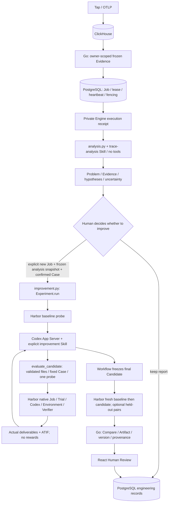

# CATENA architecture

Codex = analysis/improvement Agent. Harbor = evaluation engine.
CATENA = attribution, orchestration and engineering records.

| Source | Responsibility |
|---|---|
| `backend/internal/control/analysis_job.go` | Evidence, Job admission, private invocation, persisted result/artifacts |
| `analysis_worker.go`, `postgres_analysis_queue.go` | Durable scheduling, retry/cancel/timeout, lease and fencing |
| `review.go`, `artifact.go` | Independent Compare eligibility, immutable review, owner-scoped history |
| `engine/catena_engine/analysis.py`, `skills/trace-analysis/SKILL.md` | Analysis-only report, validated evidence references, no Harbor tools |
| `engine/catena_engine/improvement.py` | Fixed stages, trial reserve, candidate validation/freeze, score-free tool callback |
| `runtime/codex.py`, `skills/harness-improvement/SKILL.md` | Shared native Runtime, controlled task modes, strategy instructions, isolated process and audit |
| `evaluation/harbor.py`, `harbor_agent.py`, `evidence.py` | Native Harbor execution, thin target injection, TrialResult/ATIF/artifact reads |
| `executions.py`, `server.py` | Private authentication, owner receipts, operation deduplication |
| `frontend/src/AgentAnalysisLauncher.tsx`, `AnalysisWorkspace.tsx` | Configuration, state, Compare, candidate files and Human Review |

Harness² supplies method inspiration, not a runtime dependency. No Registry,
custom optimizer Host/Bench/Proposer, universal Plugin SDK or second durable queue
remains. Internal analysis Runtime is separate from the evaluated target; the
current target adapter is Codex, not a universal harness format.

The four permanent services remain Go+React, Python Engine, PostgreSQL and
ClickHouse. Codex analysis is an Engine child process. Harbor creates disposable
target containers. No new service or middleware was added.

Engineering memory reuses versioned Evidence/Candidate/Compare/Review. OpenViking
and automatic retrieval remain retired. Historical terminal Jobs are unchanged.
See [workflow contracts](IMPROVEMENT_WORKFLOW.md), [spec](../SPEC.md)
· [analysis acceptance](refactors/ANALYSIS_GATE.md) · [improvement acceptance](refactors/UNIFIED_RUNTIME.md) and [historical evidence](refactors/REBIRTH.md).
