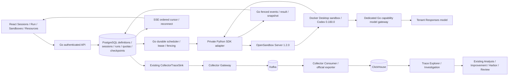
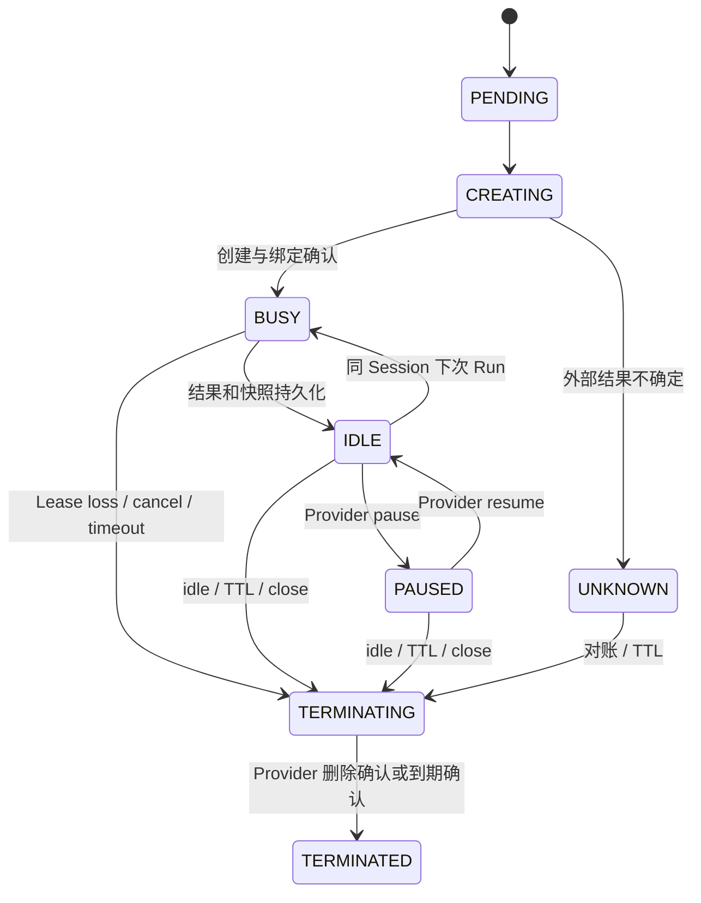

# Managed Agent Infrastructure

本轮在原工程控制面上增加托管用户 Codex 的执行链路。旧分析 / Improvement Runtime 保留原运行边界，**没有全部迁入 Sandbox**。当前是可信本地开发平台，不是恶意多租户生产沙箱。

## 架构审计与实施范围

改造前：Go 已有 Owner 鉴权、注册 Agent、加密模型配置、PostgreSQL Analysis Queue、Lease / Heartbeat / Fencing、幂等与人工 Review；Engine 有只读 Codex 分析、候选 Workflow 和独立 Harbor。Trace 采用 Collector / Kafka / ClickHouse。没有用户 Session / Run / Sandbox 生命周期。

改造后：增加独立 Managed Run 队列，复用 PostgreSQL 调度机制、原鉴权与模型密文、原 CollectorTraceSink / Trace 查询及前端结构。没有改写 Analysis 队列，没有替换 Harbor，没有引入 Redis、Kubernetes、gRPC 或 E2B。

## 已实现的业务模型

迁移 `004_managed.sql` 只增表及约束；不删除、重写历史分析记录。沿用原迁移事务和 advisory lock。

| 表 | 用途 |
|---|---|
| `managed_agents` | 不可变 v1 定义：注册 Agent ID、Codex 版本、租户模型引用、instructions、tool policy、CPU / memory、超时 |
| `agent_sessions` | 独立逻辑会话、Owner 租户、Sandbox 绑定、最新 checkpoint |
| `agent_runs` | 输入、幂等键、状态、Worker、attempt / fence / lease、确切 Sandbox ID、Trace、结果、已观察到的模型用量 |
| `managed_sandboxes` | Provider ID、状态、会话、资源限制、重建 generation、TTL、活动时间 |
| `resource_reservations`, `tenant_quotas` | 持久容量预留、租户并发 / 排队 / Sandbox 配额、模型请求预算 |
| `sandbox_operations` | 创建 / 暂停 / 恢复 / 销毁的确认或 UNKNOWN 结果、重试次数 |
| `agent_run_events` | 单调全局 event ID、Run 与 fence、有界事件历史 |
| `managed_checkpoints` | Agent 版本、格式版本、SHA-256、压缩快照、长度、Run 归属 |
| `managed_model_requests` | 请求尝试、状态、延迟、可为空的 Provider usage |
| `managed_settings` | 数据库持久 deployment namespace，防止清理其他部署的实例 |

Tenant 对应现有认证 Owner / 签名项目主体，不新增组织成员或 RBAC。Agent 定义初期固定版本 1，禁止原地编辑；模型配置引用租户当前配置，凭证仍可轮换。没有多 Runtime 插件系统。

## 调度与故障语义

- Run 先入 PostgreSQL；多进程 Worker 使用 `FOR UPDATE SKIP LOCKED` 竞争领取。短事务 advisory lock 串行化 admission / 配额预留 / claim；执行不持有数据库事务。
- 默认一个 Session 只有一个 RUNNING Run，数据库 partial unique index 再次保证互斥。其他任务持久排队。
- 按租户 `last_scheduled_at` 轮转；同时检查全局 Sandbox 容量、租户 active sandbox / concurrent run / queued run 上限。预留早于 Provider create，UNKNOWN 和 PAUSED 仍占容量。
- Go 默认 2 Worker / 全局 4 Sandbox；本机启动脚本将全局容量限制为 2。默认每租户 2 Sandbox、2 并发 Run、100 排队 Run；CPU 1、memory 1Gi。配额由部署者在数据库中调整，普通用户没有提额 API。
- Lease 默认 30 秒，心跳间隔 Lease / 4，最长 Run 1800 秒。未开始执行的任务最多 3 次尝试，指数 backoff；已开始执行的失联 Run 不自动重放。
- 所有事件、心跳、结果提交使用当前 Worker / fence / 未过期 Lease 的 CAS。旧 Worker 不能覆盖新代际结果。
- SDK adapter 在 create 和 execute 前通过私有回调校验 Run capability、Sandbox 绑定、generation 和 fence。Sandbox 内 root-owned receipt 防止重复启动同一 Run。
- Lease 丢失、取消、超时、数据库校验失败会撤销模型能力；网关每秒复核活动 Lease。Reconciler 先提交撤销与状态，再隔离 / 销毁旧 Sandbox。销毁未确认时保留预留并重试。不同 Worker 不复用尚未隔离的旧实例。
- Provider 不能原子验证数据库代际，**不能保证在租约失效瞬间停止已开始的工具调用**。执行后的失联状态是 `NEEDS_REVIEW`；旧 Sandbox 成功隔离前不启动新的 Session 执行。Provider 不可达时，旧进程可能持续到 Provider TTL，不能声称立即抢占或 Exactly-once。
- Create 超时不自动补建。通过 namespace + Sandbox metadata 查询外部结果；查不到且结果仍可能晚到时，保留容量到 1 小时 Provider TTL + 1 分钟 grace。宁可暂时损失容量，也不盲目创造孤儿。
- Reconciler 跨进程串行，核对丢失 / 非活动 / 过期 / 非法绑定 / namespace 孤儿，重试清理。空闲默认 5 分钟；暂停实例也受回收和硬 TTL 约束。

正常创建在未启动命令前直接将已健康实例绑定为 BUSY；READY 状态保留用于健康可执行资源，当前不单独制造 READY 的延迟步骤。

## 执行、快照与恢复

官方 Python SDK 在 Sandbox 中启动固定 `codex exec --json`，后续任务用保存的 thread ID 执行 `codex exec resume`。真实 Coding Agent 有 Shell / 文件编辑权限；原只读 Analysis Runtime 保持独立。

`tool_policy=sandbox-write` 表示用户代码可写容器内该用户可写的 Workspace / home / tmp，不能理解为仅凭提示词限定 `/workspace`。Codex 内层采用 `danger-full-access`；外层隔离边界是 Docker / OpenSandbox。工具环境固定最小 PATH，不继承平台密钥。实例没有宿主机目录、Docker Socket、数据库凭证或长期模型密钥挂载。

每次完整结束保存 Workspace、Codex sessions 和 thread ID；配置文件和模型 capability 不进入主动收集的 Codex 配置快照。用户代码主动写入 Workspace 的内容仍属于用户快照。快照压缩后 ≤16 MiB，展开 ≤64 MiB，最多 4096 文件，不含符号链接和设备文件。恢复校验 SHA-256，并逐项拒绝绝对路径、路径穿越和特殊文件。结果和快照在同一 fenced 事务中提交。

| 操作 | 实际含义 |
|---|---|
| Session resume | 逻辑会话 READY，后续 Run 接续已保存 Codex conversation |
| Sandbox resume | 恢复仍存在的 Provider PAUSED 实例 |
| Sandbox rebuild | 新 Sandbox ID / generation，从最后完整 checkpoint 恢复 Workspace + Codex thread |
| Run recovery | 尚未执行可重试；执行后失联标 NEEDS_REVIEW、隔离旧实例，不重放中途工具 |

`NEEDS_REVIEW` 不能直接 resume；可以关闭并保留历史记录。尚未提供“人工确认后恢复不确定 Run”的操作界面，也不保证任意模型 token / 工具中途精确恢复。快照保存在 PostgreSQL bytea，复用数据库持久化，暂不增加对象存储；没有总量 GC / 大工作区增量快照。

## 模型治理与 Trace

长期模型 Key 复用原加密配置，只由 Go 解密。Sandbox 收到每 Run 随机短期能力，限制于当前 Lease / Run / 单一 Responses endpoint。专用监听端口只暴露模型路由，**不暴露免登录本地管理 API**；所有模型路由禁止重定向。配置的模型必须匹配请求模型，强制 `store=false`、禁止 background、请求限时 90 秒、最多 3 次 429 / 5xx 尝试和 1 / 2 秒 backoff。每次上游尝试都消费预算。

默认租户 60 请求 / 分钟、每 Run 200 请求、每请求最多 4096 output tokens。是请求次数和输出 token 上限，**不是货币费用预算或完整输入 token 预算**。Provider 返回的 usage 才记账；请求表 NULL 表示未知，Run/UI 展示已观察到的 token 合计。

可信 Go 服务绑定 tenant / agent / session / run / sandbox / attempt / trace。脱敏与长度限制之后才持久事件、结果和 Trace。终态 Trace 使用原 CollectorTraceSink；Kafka / ClickHouse 不可用时保留数据库 outbox 标志并重试，重复交付由原数据面幂等读取处理。包含 Run 根 Span、模型请求 Span、工具执行 Span、排队与运行时间、Runtime / recovery 事件。

Run UI 的 Trace 链接进入现有 Trace Explorer，调查、Candidate、Harbor、Review 继续沿原接口操作。Harbor Trial 不等于用户 Session Sandbox。**本轮验证了真实 Run → Collector → Kafka → ClickHouse → Trace 查询；未重跑新 Run 的完整 Investigation → Candidate → Harbor → Review 真实质量实验。** 原业务由回归测试覆盖；本地托管配置默认不另启动 Analysis Engine，需按原部署指南配置 `CATENA_ENGINE_URL` / `CATENA_ENGINE_TOKEN` 才能运行分析。

## 本地运行

见 [部署步骤](../deploy/managed/README.md)、[API](MANAGED_API.md)、[实际验收记录](refactors/MANAGED_ACCEPTANCE.md)。

OpenSandbox 官方源码核对：[Python SDK](https://github.com/opensandbox-group/OpenSandbox/blob/main/docs/sdks/python.md)。执行入口核对：[Codex 非交互执行](https://developers.openai.com/codex/noninteractive/)、[配置](https://developers.openai.com/codex/config-advanced/)。实际固定使用 SDK / Server / execd / egress `release-1.2.0`，没有照搬旧示例中的不兼容组件版本。

## 安全与扩展边界

- Docker Desktop 不是 Firecracker。Docker 后端不支持 secureAccess；execd 是高权限内部组件，不能将非 root 命令 UID 宣称为抵抗恶意代码的完整权限隔离。端口仅发布到本机，普通 Docker 后端只供可信本地用户和受控任务。
- 出站网络默认 deny，通过官方 `dns+nft` sidecar 只允许当前 Docker Desktop 宿主网关 IP 的模型端口；不放开 DNS 或互联网。启动时实测宿主 IP，不硬编码。不能直接下载外部依赖。Sidecar 自身需要 NET_ADMIN；用户 Sandbox 不获得该 capability。
- Docker 配置 drop 危险 capabilities、no-new-privileges、PID 128；CPU / memory 限制由 Provider 实际传给 Docker。没有宿主敏感挂载或 Socket。尚无生产逃逸渗透测试、完整侧信道隔离或第三方安全审计。
- 当前未支持对象存储 GC、磁盘总配额、任意大 Workspace、成本计价、组织权限、任意运行时、跨节点 Sandbox 路由或 HA OpenSandbox 控制面。监控页明确标记实时 CPU / memory 利用率不可用，不用资源配置冒充利用率。
- 多 Worker 共享 PostgreSQL 状态；跨节点还需 Provider 路由、对象存储、网络与凭证边界、分区 / 故障域和部署者运维验证。当前单机网络地址不代表已完成多节点执行。
