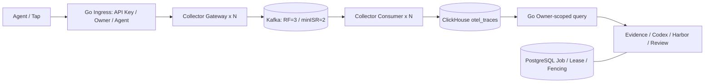

# Trace 数据面：Collector + Kafka + ClickHouse

固定组件：Collector Contrib `0.137.0`、Kafka `3.9.1`、ClickHouse `25.10.2.65`、PostgreSQL `17`。
Redis 不引入；不自研 Kafka Consumer、ClickHouse Exporter。PostgreSQL Job / Lease / Fencing 和 RSI 执行路径不变。



## 接入与确认边界

外部入口仍为 `POST /v1/otlp/v1/traces`，支持 OTLP JSON/protobuf，Tap 配置不变。
入口验证 Agent API Key，把认证身份写入 Resource 与 Span 的 `catena.owner.id`、
`catena.agent.id`。客户端提供的同名字段、名称和 `catena.internal.*` 字段均被覆盖或清除；
未绑定 Agent 的旧密钥不会保留客户端声明的 Agent ID。Authorization 不转发给 Collector。

Go 只保留请求字节数、Span 数量、进程内全局/每 Owner 并发及超时保护；没有写入任务队列。多副本需要按总预算配置，这不是跨节点的精确租户配额。
标准化后单次转发最多 30 MiB，超出返回 413，调用方应拆包；并发过载返回 429。
Collector/Kafka 不可用、部分拒绝或确认格式不正确时返回 503，客户端应退避重试。

Gateway 不使用 batch processor 或异步 sending_queue，Kafka Exporter 使用同步 producer，
`required_acks: -1`。公开入口成功表示 Kafka 已确认接收，**不表示已经可以从 ClickHouse 查询**。
Kafka 的持久性取决于副本、ISR、磁盘及保留窗口，不作端到端 Exactly-once 承诺。

Consumer 配置：

- `message_marking.after: true`，`on_error: false`、`on_permanent_error: false`；
- `autocommit.enable: true`、`interval: 1s`，仅提交已经成功处理的标记；
- ClickHouse Exporter `create_schema: false`、`async_insert: false`、`sending_queue.enabled: false`；
- 不在 Kafka Receiver 与 Exporter 之间插入异步 batch/队列；导出失败持续退避，`max_elapsed_time: 0s`。

因此一次处理的返回依赖实际 INSERT 完成，而不是内存队列接收。落库成功、位点提交前进程退出
仍可能重投。永久错误会阻塞分区，不能通过开启 `on_permanent_error` 丢弃来“恢复吞吐”；应排查记录、
修复配置或由管理员保存并处置。当前 topic 保留 7 天，磁盘和积压告警必须覆盖可恢复窗口。

默认三 Broker 使用 KRaft，多 Gateway/Consumer 可通过 Compose `--scale` 扩展。它们不发布外部端口；
只有 Go 面向 Agent。生产部署需把 Collector/Kafka/ClickHouse 限制在可信网络，并配置各服务的最小权限
身份、TLS/ACL。单机三容器验证的是进程故障，不等于三个独立故障域。

## 官方兼容 Schema 与读取幂等

版本化 SQL 在 `deploy/catena-mvp1/telemetry/migrations/`，由一次性 `clickhouse-migrate` 服务执行；
应用与 Exporter 不自动建表。已应用版本和 SHA-256 保存在 `catena_trace_schema_migrations`，重复执行检查校验和；已应用文件不能修改，应增加后续迁移。001 保持固定版本官方 Exporter 的 22 个 INSERT 列及类型，包括
`TraceId`、`SpanId`、`ParentSpanId`、`ResourceAttributes`、`SpanAttributes`、Events 和 Links。
来源：[traces_table.sql](https://github.com/open-telemetry/opentelemetry-collector-contrib/blob/v0.137.0/exporter/clickhouseexporter/internal/sqltemplates/traces_table.sql)
与 [traces_insert.sql](https://github.com/open-telemetry/opentelemetry-collector-contrib/blob/v0.137.0/exporter/clickhouseexporter/internal/sqltemplates/traces_insert.sql)。

自管 Schema 额外增加材料化 Owner/Agent、会话、模型、短预览和默认摄取时间列。排序键为
`(CatenaOwnerId, TraceId, SpanId)`，按 Owner 的稳定哈希分 16 个分区；同一身份不会因为时间戳修改跨分区。
表为 `ReplacingMergeTree(CatenaIngestedAt)`，002 的只读查询视图在聚合前执行 `FINAL`，不等待后台合并。
相同 Owner + TraceId + SpanId 的重投只读取一次；不同 Owner 的相同 ID 互不覆盖。
冲突内容采用摄取版本替换，不能把重投幂等理解为不可变审计或外部 Exactly-once。

官方 Exporter 会把属性值转换为字符串，且不保存全部 OTLP flags/schema/drop-count 字段。
入口生成 `catena.internal.meta.v1` 版本化元数据，保留既有类型化 Evidence、事件、链接及遗漏字段；
它是普通 OTLP 属性，由官方 Exporter 原样存入 Map。查询视图还原旧查询契约，不存在第二个 Writer。
这会增加存储开销，容量评估必须使用实际包含元数据的负载。列表通过材料化窄列读取，详情才解码完整元数据。

Go 查询仍逐次按 Owner 过滤，Agent/时间窗过滤位于 LIMIT 前；模型展示采用最早 Span 的稳定顺序，
避免同一 Trace 含多个模型时使用 `anyIf` 得到不确定结果。

## 迁移、切换与回滚

本变更不自动 ALTER、删除或重写 `catena_spans`，也没有对线上环境执行迁移。新安装的示例 `.env` 显式设置 `otel`；已有环境未设置此变量时保留 `legacy` 读取，防止未经真实 Trace 对照自动切换。
已有部署应按以下顺序实施维护窗口或稳定快照迁移，不能把此工具当作在线 CDC：

1. 备份旧表和配置；冻结旧 Trace 写入或取得稳定快照，避免分页过程中新增/修改记录。
2. 启动 Kafka、Collector 和 schema migration，验证 001/002 已执行且 Exporter 能 INSERT。
3. 由管理员按 Owner 重放历史 Trace；工具只读旧表、通过 Collector 写新链路：

   ```sh
   cd backend
   # 环境变量指向旧表所在数据库和可信的内网 Collector Gateway。
   # CATENA_CLICKHOUSE_DSN / CATENA_COLLECTOR_URL 不包含在提交的脚本中。
   go run ./cmd/catena-trace-replay --owner OWNER_ID
   # 从最后成功输出的游标恢复；重投读取幂等。
   go run ./cmd/catena-trace-replay --owner OWNER_ID --after-trace LAST_SUCCESSFUL_TRACE_ID
   ```

4. 对真实业务 Trace 比较 Owner/Agent、Trace/Span 身份集合、层级、属性、事件、输入输出及查询结果；
   fixture/合成负载通过不能替代这一步。暂停写入期间的客户端记录也需补传、对账。
5. 切换 `CATENA_TRACE_BACKEND=otel`，新写入经 `CATENA_COLLECTOR_URL`；恢复客户端上报，验证积压排空。

`CATENA_TRACE_BACKEND=legacy` 只把查询切回保留的历史表，不 ALTER 旧表；新写入仍走 Collector，
因此新数据不会出现在旧读视图。需要完整退回旧写入架构时，使用备份的旧部署版本及明确的数据补传计划。
不做双写或静默合并两份数据。旧 Writer 仅保留为迁移对照测试代码，生产启动路径不再调用它。
确认真实业务验收和保留策略之前，不删除旧表、Kafka 卷或 PostgreSQL 数据。

## 验证与压测

```sh
# Compose 2.20+（include 支持）。按环境实际端口配置测试 DSN。
docker compose -p catena-trace-study -f deploy/catena-mvp1/compose.yml \
  -f deploy/catena-mvp1/compose.telemetry-test.yml \
  up -d --scale otel-gateway=2 --scale otel-consumer=2 clickhouse otel-gateway otel-consumer
# 从 docker compose port / docker port 获取 Gateway 的随机 loopback 测试端口。
cd backend
CATENA_OTEL_TEST_DSN=... CATENA_OTEL_TEST_GATEWAYS=... \
  go test -count=1 -v -run 'TestCollector|TestOTelExporter|TestOTelAuthenticated|TestOTelReplay' ./internal/control
```

`compose.telemetry-test.yml` 仅为测试暴露随机 loopback 端口，不用于公网部署。
另设真实 Trace 数据面压测（明确开启才运行）：

```sh
# 独立 catena-trace-* 项目，初始 topic 必须是 6 分区；脚本会增加到 12，不能原地缩回。
# 设置本地隔离 PostgreSQL 的 BARENA_TEST_DATABASE_URL；不可指向生产数据库。
python3 scripts/benchmark_trace_pipeline.py --project catena-trace-study --seconds 60
```

脚本运行固定负载的 Gateway/Consumer/分区对照、千租户查询、ClickHouse 停机与 Consumer 强杀、
Broker 不可用检查。Go 鉴权使用真实 PostgreSQL；不启动模型/Harbor。入口并发配置为每进程 16、每 Owner 2，
生产默认并发仍为 4；结果必须注明这项配置差异。发送响应计时与落库计时分别记录，最后逐项核对身份集合。
每组含扩容后的冷启动/rebalance，不能当作纯稳态极限吞吐；60 秒基线不证明长期企业级容量。
原始结果、位点和资源样本保存在 `artifacts/cloud-workspace/trace-pipeline/`。

旧版 Writer 与新链路的同机 A/B 见 [2026-11-08 对照报告](benchmarks/trace-writer-collector-ab-20261108.md)：通过 Git 归档恢复旧代码、相同公共请求体、预热后按 ABBA 顺序比较，另做相同停库故障。复现入口为 `scripts/benchmark_trace_ab.py`；每次重跑使用新的证据目录，不覆盖已有结果。

进一步的 [容量阶梯报告](benchmarks/trace-capacity-20261108.md) 单独比较目标量、实际发送、拒绝率、60 秒 INSERT 完成量和排空量。该轮未达到持续 3000 Span/s，不把 10000/20000 Span/s 的输入目标当成实际容量。复现入口为 `scripts/benchmark_trace_capacity.py`。
