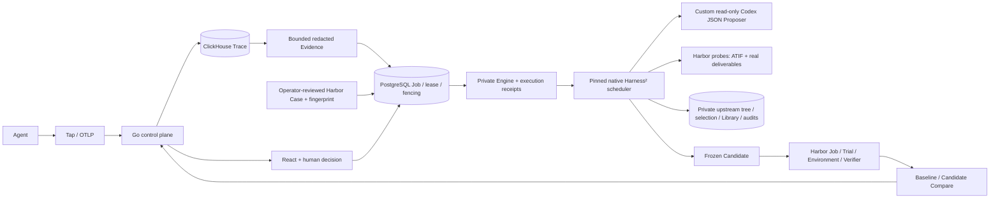

# CATENA architecture

CATENA is a Trace-driven Agent Engineering Control Plane.

Go owns identity, evidence, scheduling, persistence and audit. Harness² owns its
optimization algorithm. Harbor owns all target Agent execution and verification.
The small Codex subclass only installs validated harness files and supplies private
owner credentials. The optimizer model transport cannot execute shell commands or
read host Skills. Candidate files and registered Cases remain separate from verifier
outputs; rewards never enter proposer context.

The pinned upstream Proposer only supports Claude CLI/OpenCode; our Codex JSON
transport is an explicit custom channel, not native Proposer equivalence. Harbor
supplies native TrialResult metrics, ATIF and pre-verifier collected output files.
Harness² sees real task artifacts rather than assistant summaries. Native upstream
runs and the experiment-scoped Library persist alongside Harbor evidence. Exact
contracts and current limits are in [the integration guide](../../RSI_ADAPTERS.md).

A single durable PostgreSQL queue handles admission, leases, heartbeat, fencing,
retry, timeout and cancellation. Engine receipts identify external paid operations,
not another queue. An uncertain receipt after restart requires inspection before
any replay. One Engine instance owns each receipt root.

After candidate freeze, Harbor runs a fresh baseline/candidate pair. Optional
held-out Cases remain distinct from the optimization Case. Go retains the full
comparison checkpoint and artifact provenance. Human decisions append atomically
to the terminal Job; they cannot overwrite verifier results or authorize automatic
installation. Unknown cost/usage remains unknown. One pair establishes no general
improvement.

OpenViking, Memory, embeddings, community and algorithm registries are retired.
Historical tables/terminal records remain for export. No provider-specific runtime
is required to read retained artifacts. Explicitly authorized Markdown/AGENTS.md
text is the only reserved future team-context boundary.

[Current spec](../../../SPEC.md) · [Implementation and evidence](../../refactors/REBIRTH.md)
