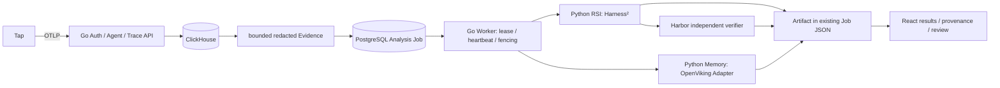

# Catena V2 架构收敛记录

基线：`8ac6708ca10bab0b87913bd2d62d5dcb7fbf5bea`。本报告按六个 Phase 更新。

## Phase 1：依赖审计

| 旧职责 | Go 调用方/存储 | Engine | UI/部署 | 处理 |
|---|---|---|---|---|
| 三 Role | evolution_job.go 的执行与输出修复；evolution_runtime.go 的 Role RPC；EvolutionJob Queue | roles.py、runtime.py、/v1/turn | EvolutionWorkspace、Launcher、协议类型 | 迁移 Evidence/Queue/Candidate，删除固定 Role 执行与专属测试 |
| GauzMem | memory.go 中 Client、通用数据、Handler、Evidence 混合 | 无 | memory profile、MySQL/Neo4j/Qdrant、Dockerfile.gauzmem | 通用能力保留，OpenViking 迁移后删除提供方专属实现 |
| OpenViking | openviking_memory.go、owner header/URI 约束、memory task records | 待迁移为 Memory Adapter | compose.openviking.yml、CPU embedding | 迁移到 Engine，保留 owner 隔离和异步任务来源 |
| Barena | Runner、Run/Issue/Case/Replay/HarnessVersion/Release、Run Bundle、Scenario adoption、Store/Postgres 方法 | 固定 rg-missing-search Worker/Bridge/Coordinator | runner-client、Dockerfile.runner、ExperimentWorkspace、构建上下文 | 正式路径删除；实验集与有效报告保留 |
| 通用基础 | Trace/Agent/Auth、MemoryStore、Postgres、Lease/Heartbeat/Fencing、Retry、取消、脱敏 | 私有服务鉴权、隔离 Codex transport、RSI/Harbor adapter | Trace/Agent/Memory/Outputs | 保留复用 |

发现：旧 Runner 默认缺 SPIRAL_RUNNER_URL；该链被正式退役，不为其继续补部署。旧 Conversation 写 Handler 没有路由，历史读取不与写 Handler 的去留混同。认证表 `barena_users`/sessions/api_tokens 不删除。GauzMem 不等于 Go MemoryStore。

### 基线验证

- `/tmp/go/bin/go test ./...`：通过（未配置数据库的集成测试仍按原条件跳过）。
- 独立 Harbor Engine 环境 `pytest`：104 passed / 7 Windows-only skipped。
- 前端 pnpm test、typecheck、build：均通过，日志 /tmp/catena-v2-baseline-web.log。
- 核心源码计数：103 个文件 / 30,658 行。口径为 control-plane、engine、catena-web/src、tap/catena_tap 中 .go/.py/.ts/.tsx，排除 *_test.go、tests、Go 内嵌 Web。最终使用同一口径，不将冻结实验快照计入核心。

## 迁移与验收边界

目标：Trace → Evidence → Analysis Job → Artifact → Evaluation / Review。RSI 与 Memory 是平级 Pipeline，共用原持久队列和审计身份，不互相作为启动前提。Harbor 只负责 Evaluation。

数据库采用增量、可版本化迁移；历史认证和业务表保留，不执行 DROP/清空。旧执行请求不得被 V2 当作新模型任务重放。Engine 的执行 receipt 只消除重复外部启动，不提供第二套轮询队列或租约。

本任务不自动调用收费模型、不发布公网服务。真实模型、Docker Harbor、OpenViking 提炼缺少实际条件时记录 BLOCKED，不用 fixture 通过率冒充真实评测。

## Phase 2：基础契约

增加 Artifact Envelope 与 Job pipeline/adapter/options/checkpoint 字段，暂时允许旧编排共存。Artifact 存在原 Job JSON 文档中，通过原 SaveLeasedJob 原子落库，不新增第二套队列或产物数据库。写入验证 owner/job/evidence，读取按 owner 过滤；认证和历史表不变。Go 全套单元测试及新增 owner/fenced Artifact 回归通过。

## Phase 3：RSI 迁移

正式创建入口为 `POST /v1/analysis-jobs`，Worker 复用原 PostgreSQL lease/heartbeat/fencing，调用私有 `/v2/rsi`。候选、父版本、Case fingerprints、Harbor trial 证据和状态保存于 Job JSON/Artifact；无真实验证不标为 verified。界面读取新任务及 Artifact，选择管理员注册的 Harbor Case。

固定三 Role Prompt、SDK、RPC 和专属测试退役。历史固定 rg Worker/Bridge/Coordinator 等移至 `research/legacy-engine`，不再打包；复现实验应 checkout 基线。通用 Codex JSON transport 保留独立 HOME、子进程组终止、输出上限。Engine 私有 token + Go owner，执行 receipt 持久化（不存凭据），重试不重复启动已完成/仍在运行的付费操作；进程崩溃留下不确定 running 时拒绝自动重放，要求人工核查。默认单分析槽，不阻塞 health/receipt/查询。

验证：Go 全套单元测试通过；Python 55 tests 通过（含真实 pinned Harness² 的确定性适配测试、Harbor Adapter 和 Codex 子进程 timeout/cancel 测试）；React typecheck 通过。Go HTTP→原 Worker→私有 Engine stub→Artifact 持久化为协议集成测试；不冒充真实模型或 Docker Harbor 成功率。真实付费模型调用未授权、未执行。

## Phase 4：Memory 迁移

OpenViking HTTP、trusted identity、owner URI 检查、文件/关系/搜索与异步提炼迁至 Engine Memory Adapter。Go 仅通过私有 Engine token/owner 访问；不持有提供方密钥。`catena_<sha256(catena-memory:owner)[:24]>` 映射、48-bit 文件 ID 与原数据兼容。GauzMem Client、Dockerfile、MySQL/Neo4j/Qdrant 专属服务配置删除；现有数据卷不删除。

Memory 独立 `pipeline=memory`：先保存 provider task ID checkpoint，再轮询；临时失败的重试只恢复 status，不重复 commit。Artifact 保存原 Evidence 引用/哈希、提供方任务和原生结果，不把整个 owner 的现有文件冒认成本次提炼结果，状态为 extracted 而非 confirmed。旧直接提炼 API 退役，Trace 提炼按钮进入同一队列。provider 已接受的远程提炼在 Go 取消后可能继续，Catena 停止轮询、不发布其产物；未宣称具备提供方事务回滚。

验证：Go 全套通过，含持久化 checkpoint 后临时失败/重试/只提炼一次；Engine 57 tests 通过，新增原 owner 哈希、越界 URI、跨 owner task/搜索/文件、跨 Engine receipt 重启不重复 commit。均为协议 fixtures；此环境未配置 OpenViking/模型凭证，真实提炼 BLOCKED。

## Phase 5：退役 Barena

删除 Node Runner、Runner client、Run bundle、Scenario adoption、Issue→Case→Replay→Release 自动晋级及固定 Experiment HTTP/Store/内存/PG 实现。先迁移 newID/bounded/Trace ID 校验等共享函数。认证表、用户/Agent/API token、Go MemoryStore、历史会话读和队列保留。公共 Profile 保留基本资料，移除以旧 Run 推算能力评级。HTTP 构造收敛为 `NewHTTPHandler(Store, HTTPConfig)`。

前端移除专用 Experiment 导航/页面；输出页读 Artifact/来源/Harbor 结果。历史 Conversation 的记忆操作也进入同一 Analysis Job，通过 owner-scoped 历史读取生成脱敏 Evidence，不再有独立提炼任务调度器。Harbor Adapter 移至 `engine/evaluation`，固定实验 Worker 已归档；删除同步 RSI CLI，Go Queue 为唯一正式启动路径。Compose 和 core image 不再构建 Runner/XiaoBaOS。

本阶段 Go tests、React typecheck 通过。研究数据、冻结 Release、Verifier 结果及报告原位保留；过时代码在 research/legacy-engine 并标注仅历史用途。生产旧表数据不 DROP/DELETE。

## Phase 6：最终架构与验收

当前主链路为 Trace → Evidence → Analysis Job → Artifact → Evaluation / Review。

目录收敛在现有 Go control 包内，避免循环依赖。主命令为 cmd/catena-server；类型为 AnalysisJob/AnalysisLease，EngineClient 只负责私有 RPC。Engine/runtime/codex.py 是通用 JSON transport，Engine/evaluation/harbor.py 可复用。没有引入新框架、第二套队列或新数据库。

### 删除与保留

| 范围 | 处理与原因 |
|---|---|
| 固定 Role | 固定 Inspector/Evolution/Reviewer 编排、Prompt、RPC、输出修复、阶段 UI 和专属测试退出正式代码；通用 Evidence/Queue/Codex 生命周期保留 |
| Barena | Runner/进程管理、runner-client、Run bundle、adoption、Issue/Replay/Release 晋级、固定 Experiment Handler/Store 实现删除；迁移共享函数后再删除确认无调用方的剩余函数 |
| GauzMem | Client、Dockerfile、专属 MySQL/Neo4j/Qdrant 服务和配置删除；MemoryBackend、脱敏、Evidence 转换和 Go MemoryStore 保留 |
| 前端 | 专用 Experiment、固定 Role/候选旧解析与样式删除；Analysis Job / Artifact 来源、文件复制下载、验证详情接入；Trace/Memory/Agent/连接与历史会话保留 |
| 部署 | 默认仅 core/engine/postgres/clickhouse；Memory 与 RSI 分开显式 overlay；不再构建 Barena/XiaoBaOS |
| 研究 | 14 个专用 Engine Python 文件、共 1,482 行移至 research/legacy-engine，不打包、不作为当前运行入口；evals/冻结证据/有效报告未删除 |
| 通用工程能力 | Trace 准入/限流/背压、ClickHouse、Auth/Agent/API token、加密模型配置、PostgreSQL Lease/Heartbeat/Fencing/Retry/Cancel/Timeout/恢复及 Harbor Adapter 保留 |

[完整文件变更清单](evidence/v2/file_changes.tsv)。按 Git rename 检测，37 个源码文件标记为删除（包含已退役测试，不包括重命名/归档）；具体分类以清单为准。

### 兼容性与安全迁移

- 新任务只通过 POST /v1/analysis-jobs，旧 Role/Run/Replay/Experiment API 返回 404。默认 HTTP 构造只有 NewHTTPHandler(Store, HTTPConfig)。旧 /evolution 页面地址作为输出页深链接保留，读取的是新协议；历史记录不会被强行解析成新候选。
- 保留 barena_users/sessions/api_tokens 等认证表、catena_evolution_model_configs、spiral_evolution_jobs 与既有密钥 envelope prefix，用户/凭据不改名重建。历史业务表留在旧数据库中；新安装不创建 Run/Replay/Experiment 表。
- migrations/001_core.sql 幂等保留基础，002_v2.sql 记版本并仅将旧 schema 活跃 Job 标为 retired/failed。原始 document 使用 jsonb_set 更新状态，历史 Role 输出和终态记录保留；不 DROP 表、不清空生产数据。隔离 PostgreSQL 测试验证了重入、原始字段保留及新安装无旧表。
- Artifact 复用 Job JSON，与 lease/fence 原子保存；写入校验 owner/job/evidence，读取按 owner/type 过滤。候选保留完整版本/父版本/内容哈希与 Harbor 来源，验证前仍为 unverified；存在 held-out Trial 时为 review_required，也不代表改善已成立。
- Memory 可独立启动，无需 owner RSI 模型配置。提炼 checkpoint 先落库再查询；旧文件 owner 哈希/URI/48-bit ID 保持兼容。Memory Artifact 为 extracted，保留 provider task/result 和来源；没有文件级归属证据时不把整个记忆库归为本次产出。
- Evidence 哈希排除单纯的打包时间，以免相同 HTTP 重试误报冲突；审计时间仍保存。只有 Go 认证上下文能确定 owner，Engine 使用私有 token，不接受浏览器直接传递的 owner 身份。

### 实测结果

| 验收项 | 状态 | 证据与边界 |
|---|---|---|
| Go 编译、单元、vet | PASS | [unit](evidence/v2/go-unit.log)、[vet](evidence/v2/go-vet.log) |
| Go + PostgreSQL + ClickHouse + race | PASS | [数据库 race 日志](evidence/v2/go-race-databases.log)：真实隔离 Docker 数据库；含原租约/恢复/取消/重试/fencing 与 Trace 存取测试 |
| Go Queue → 独立 Python HTTP Engine → Artifact → PG 重开 | PASS / fixture | pipeline_postgres_integration_test.go：RSI/Memory 两条路径、持久化与 foreign owner 不可见；模型和提供方响应为合成 fixture，未运行真实 verifier |
| Engine 干净依赖与测试 | PASS | [57 passed](evidence/v2/engine-clean.log)、[ruff](evidence/v2/engine-ruff.log)、[pip check](evidence/v2/pip-check.log)；Harbor 0.23.0 / pinned upstream Harness² / OpenAI 2.54.0，未安装 openai-agents |
| Codex timeout/cancel/清理 | PASS / fixture CLI | 保留真实子进程组超时、抗 TERM 子进程、输出大小、隔离 HOME 测试；Go request deadline 也向 Engine 发取消 |
| React 类型/构建/内嵌包 | PASS | [build](evidence/v2/web-build.log)，生成包与 Go embed diff 一致 |
| Web 单元/浏览器 | PASS | [48 unit](evidence/v2/web-unit.log)、[15 browser](evidence/v2/web-browser.log)，含来源深链接、取消/Artifact、窄屏与失败恢复 |
| Tap / 已有 deterministic Verifier | PASS | [28 Tap tests](evidence/v2/tap.log)、[28 tasks / 116 verifier checks](evidence/v2/verifiers.log) |
| Compose | PASS / config | base/public/rsi/openviking config + shell syntax；默认四服务。不是整栈镜像运行验收 |
| 真实模型 Harness² → Harbor → Candidate | BLOCKED | 本轮没有配置/使用真实模型授权凭据；没有模型费用、Token/质量提升或 Harbor 通过率结论 |
| 真实 OpenViking 提炼/检索 | BLOCKED | 未配置实际提供方服务与模型；已验证 HTTP/owner/checkpoint/结果映射协议，不能等同实际提炼 |
| 目标生产部署 / 全栈镜像 / 性能 | 未验证 | 本轮为托管工作区与隔离 Docker DB；没有部署用户目标服务器，不声明 2 核8GB容量或 50 用户结论。CI 另有 Engine image smoke |

全部[命令、环境与限制](evidence/v2/COMMANDS.md)。GitHub CI 以该 PR 的 Checks 为准，本报告的 PASS 指已执行的本工作区测试。

### 代码变化与可复跑统计

[统计 JSON](evidence/v2/source_inventory.json)，命令 python scripts/source_inventory.py。口径与 Phase 1 完全一致：control-plane、engine、catena-web/src、tap/catena_tap 的 .go/.py/.ts/.tsx，排除 tests、*_test.go、内嵌 Web、CSS 与 research/evals。

- 基线 103 文件 / 30,658 行；当前 93 文件 / **19,868 行**。
- 核心净减少 **10,790 行（35.2%）**；其中 1,482 行是保留的归档移出核心，余下净减少 9,308 行，不能把全部退出核心的行数称为物理删除。
- 测试数量下降主要来自明确退役的 Role/SDK/Barena 业务；保留通用队列、Trace、Auth、Harbor、Codex 子进程清理，并新增两条 Pipeline/Artifact/迁移/owner/幂等回归。没有靠跳过全部 Harbor 覆盖通过。

### 剩余技术债与部署风险

1. Engine receipt 为单实例、持久卷内的外部操作去重；不是分布式 exactly-once。进程崩溃留下不确定 running 时人工核查，不能自动重放付费操作。
2. OpenViking 已接受的远程任务可能在 Go 取消后继续；Catena 不发布产物，不宣称提供方任务可事务回滚。
3. Harbor Docker socket 具有宿主控制权限，必须 operator opt-in、可信 Case、同路径挂载、正确 Docker GID 和网络/凭据策略。原生 Trial 可执行工具，不能套用只读分析 transport 的安全假设。
4. Engine 1CPU/1GiB 与 Harbor Trial 1CPU/1GiB 分属不同 cgroup，需单独预算；本轮没有测量目标单机容量。Artifact 查询扫描既有 Job JSON，未声称海量产物索引性能。
5. 保留旧 DB/module/envelope 名称与历史只读记忆 ledger 以避免破坏数据；不再维护旧执行器。旧终态 Role 产物未自动转为 V2 Artifact，原数据需通过历史导出或基线查看。
6. 真实模型和 OpenViking 验证仍是交付阻塞项。**代码结构已收敛为一套队列、一条正式 RSI 路径和一条独立 Memory 路径；不能据此宣称真实 Agent 质量验收通过或生产可冻结。**

### 最后安全复核与远端 CI

补齐旧脱敏正则遗漏的明文 `sk-…` token，保留 underscore token 兼容，并在原 bounded/redacted Trace 测试中加入合成回归。修改后的完整 PostgreSQL/ClickHouse race 套件再次通过，日志已更新。

[GitHub Actions 41176649375](https://github.com/fightheyyy/CATENA/actions/runs/41176649375) 在 `616c7c9` 的五项检查全部通过，包括真实 Engine 镜像构建、Codex / Docker Compose 版本与私有鉴权 smoke；这属于 GitHub hosted runner 验证，不是本地 Docker 或目标生产服务器。后续脱敏修复的最终状态仍以 PR 最新 commit 的 Checks 为准。[原始 CI 状态](evidence/v2/ci-616c7c9.json)。
