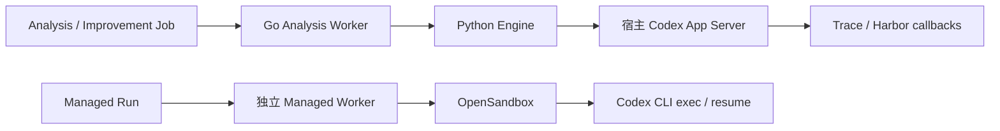
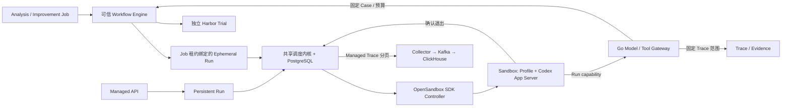

# ADR：三个 Profile 共用 Agent Harness 与 OpenSandbox

## 决策

Analysis、Improvement、Managed 使用同一个 Codex App Server 适配、OpenSandbox SDK 控制器和调度内核。Profile 提供版本、角色指令、Skill、Knowledge 引用、能力与 Session 策略。Go 授权模型和可信工具。Python Engine 只执行确定性工作流、验证结果和运行 Harbor。用户 Agent 与内部 Agent 均由 Sandbox 内的入口启动。

| 模块 | 责任 |
|---|---|
| Go `scheduler.go` | Worker 启停、轮询与唤醒、Claim 超时、退避、Heartbeat 和取消传播。业务保留自己的 Claim、Fencing、重试决策和计数。 |
| Go `analysis_workflow.go`、Python `analysis.py` / `improvement.py` | 固定调查范围、来源证据校验、独立 Case 与实验预算、候选冻结和结果持久化。 |
| Go `harness_workflow.go` | 私有 Job capability、一次性 Ephemeral Turn 绑定、按 Profile 和活租约授权工具。 |
| Go `managed_store.go` / `managed_reconcile.go` | Run 与 Sandbox 所有权、容量预留、持久操作意图和故障隔离。 |
| Python `managed/server.py` | OpenSandbox SDK、Provider 边界与错误分类、确认前台命令退出。 |
| Sandbox `runtime/codex.py` / `managed/entry.py` | Profile 装配、Thread Start/Resume、原生 Skill、动态工具、流式事件、结果与 checkpoint。 |
| Sandbox `managed/foreground.py` | Linux subreaper 验证 App Server 及其工具后代已退出，含脱离原进程组的工具。 |

统一 Harness 是为了让三个场景的协议、授权与隔离修复只落一处。保留 Workflow 是因为证据有效性、Case 指纹、实验预算、人工 Review 和未知副作用的恢复规则属于业务。Codex 负责推理与工具规划，Harbor 负责独立评测。保留已有业务 Job 表和基础设施 Run 表，分别表达业务进度与资源执行所有权，避免双重业务调度状态。没有引入新的队列表、Agent Registry 服务、微服务或通用插件框架。

## 生命周期

- Job 领取后由 Go 持有 Job lease。Engine 只拿到短期 Turn capability，不能选择其他 Job、租户、Profile 或 Sandbox。Analysis 的只读工具查固定 Trace 范围，Improvement 的工具进入同一 Engine 中为该 Job 注册的回调，仍由原 Workflow 校验候选路径、Case 和预算。
- Run 领取时独立发放 execution lease、fence、模型和工具 capability。内部 Session 绑定一次 Job lease，Job lease 失效后不再领取或调用工具，旧 Run 不会在新 Job lease 下重放。Engine receipt 保留既有幂等语义。内部执行记录隔离于公开 Managed API 与 Managed Trace 索引。
- 默认 Managed 容量之外预留 **一个**内部 Sandbox 槽和一个 Worker。Managed 本机上限两个，启用 Engine 后的整机 Sandbox 上限三个。模型租户预算仍共享。Admission 和模型预算使用租户行锁，持久 Sandbox 分配保留短容量事务。Provider 请求在事务外执行。
- 正常结果要等 App Server 报告匹配的 Turn 完成、所有命令结束、进程组退出、Linux 后代检查通过和 SDK 确认退出，Go 读完执行流后才提交。Persistent Session 保留 checkpoint 并可复用 Sandbox。Ephemeral Session 终态后进入删除，Provider 确认回收才释放容量。
- 取消、超时或未知命令结果撤销 capability，Run 进入 `STOPPING`。取消通过隔离旧 Sandbox 达到强制停止，运行时协议没有把通知送达当成停止证明。旧实例确认销毁后才提交取消/待审等终态。已发生的外部副作用不能撤销。未知创建和销毁继续沿原 Operation Intent 和 CAS 恢复。
- Trace 读取使用同一 Collector 数据面，分页、跨页工具 Span 和 ACK 重试保留。Analysis evidence 继续走原 Artifact 契约。Harbor 容器不进入用户 Session 或共享它的 checkpoint。

## 升级

1. 停止新任务，等待旧 Analysis、Improvement、Managed Run 完成或取消并隔离；导出需保留的 checkpoint。持久会话的下一 Turn 只在 Sandbox 使用新镜像后运行，因此先回收旧物理实例。
2. 构建新 Sandbox 镜像，成对部署 Go、SDK Adapter 和可信 Engine。007 增加可选 Profile 字段，旧 Managed Profile 自动保留既有 `sandbox-write` 权限。006 增加内部 Job 绑定和能力索引，历史 Job、Evidence、Artifact、Run、Review 行保留。
3. 将 `CATENA_MANAGED_CONTROL_URL` 指向 Sandbox 可达的专用 capability listener，`CATENA_CONTROL_URL` 指向可信 Engine 可达的 Go 控制入口。普通 Compose 在没有 Provider 配置时仍能读取历史数据，业务执行需要配置 OpenSandbox。
4. 本机复现见 [部署命令](../../deploy/managed/README.md)。当前支持可信单机 Docker。恶意多租户隔离、跨节点路由与高可用未验收。Engine receipt 与活跃工具回调要求同一可信 Engine 实例，滚动升级先排空。

## 验收

以 PR #6 的 `265876e` 建立基线，Go PostgreSQL race、Python 54 项、前端 38 项与浏览器 13 项通过。

### 真实运行

`caffeinate -i python scripts/managed_load.py --environment <local-env> --output <grading.json>` 在 Apple M5 / 16 GiB、Docker Desktop、OpenSandbox 1.2.0、Codex 0.160.0 和真实 Responses 模型上运行。每档两个持久 Session，每实例 1 CPU / 1 GiB / 128 PIDs。每 Run 上限四次模型请求、每次最多 1024 output tokens、租户每分钟 30 次请求。每个 Run 实际生成并执行 Python 代码，核验产物、快照和退出证据。两 Sandbox 代表执行并发，10 / 20 / 50 代表同时提交的任务数。

| 并发提交 | 真实执行通过 | 排队 P95 | 执行 P95 | 冷分配 P95 | 模型请求 | input / output tokens |
|---:|---:|---:|---:|---:|---:|---:|
| 10 | 10/10 | 75.68 s | 19.99 s | 2.24 s | 20 | 100,416 / 3,419 |
| 20 | 20/20 | 144.20 s | 17.96 s | 1.94 s | 40 | 252,575 / 6,403 |
| 50 | 50/50 | 377.63 s | 17.79 s | 1.95 s | 100 | 1,061,594 / 17,053 |

[分级证据](unified-harness-evidence/grading.json)保留每个 Run、用量、产物哈希和 Docker 采样统计。50 档 0.147 秒提交完，418.993 秒完成。每档 Managed 峰值均为两个，结束预留归零；采样峰值 22.77% CPU、99.00 MiB、65 PIDs。冷分配每档仅两次，不能用于外推 SLA。这批测试使用已统一 App Server 的集成镜像。最终版本的类型化 adapter 和 Linux 后代检查另行通过真实 Profile、Analysis 和 Worker 崩溃验证。

- [Managed 会话](unified-harness-evidence/managed-smoke.json)：三轮真实执行，含复用、pause/resume、checkpoint 与物理 Sandbox 丢失后恢复。
- [自定义 Profile](unified-harness-evidence/profile.json)：最终镜像加载只读 Managed Skill，模型返回只存在于 Skill 中的标记。
- [Analysis](unified-harness-evidence/analysis.json)：最终镜像读取真实 Managed Trace，执行 `list_traces` 与 `get_trace`，返回带来源引用的 `analysis_report`。首次集成尝试因 Worker 仍要求临时会话提供 checkpoint 而失败，修复后同场景重跑通过。
- [Improvement 工具契约](unified-harness-evidence/improvement-contract.json)：最终镜像中的真实 Codex 调用 `evaluate_candidate`，通过正式候选校验器检查变更范围，并读回测试回执、返回合法结构。测试 Engine 故意拒绝生成业务 Artifact，Job 记录为失败且 Artifact 为 0。该结果只证明工具契约。
- [Worker 强杀](unified-harness-evidence/worker-crash.json)：在真实 90 秒工具命令中发送 SIGKILL，27.046 秒确认隔离，fence 1 → 2，旧 Run 进入 `NEEDS_REVIEW` 且不重放。Docker 内单独验证 Linux wrapper 拒绝仍存活的 `setsid` 子进程。
- [Trace 覆盖](unified-harness-evidence/trace-coverage.json)：80 个 Run 的 800 个事件逐条与 PostgreSQL 匹配。74 组相邻同 Session 执行没有重叠。Worker 崩溃 Run 也读回 8 个事件。最后核对活跃、排队、预留、Sandbox 与 sidecar 全部为零。独立 PostgreSQL 协议测试覆盖 255 条事件、跨页工具 Span 和 ACK 丢失。此前真实 Collector 故障重试记录见 [PR #6 验收](MANAGED_CONSISTENCY.md)。

### 回归与范围

- 独立 PostgreSQL 上运行 `go -C backend test -race -count=1 ./...`，配置 `CATENA_ENGINE_TEST_PYTHON` 运行 Go / Python 跨进程协议。并发 Claim、租约和越权、配额隔离、Provider 慢响应、故障接管和状态收敛通过。 `go -C backend vet ./...` 通过。
- `cd engine && python -m pytest` 54 项通过，覆盖 Analysis、Improvement、Harbor contract 和 Sandbox adapter。Ruff 通过。 `pnpm -C frontend test` 38 项、`pnpm -C frontend test:browser` 13 项通过，覆盖 Compare 和 Human Review。
- 两个 Compose 配置校验通过。实际构建 Engine 和 Sandbox 镜像，Engine 的 `command -v codex` 返回不可用，Sandbox 固定 Codex 0.160.0。宿主 App Server 启动入口和单独 CLI exec/resume 适配已删除。 Harbor 独立保留其任务运行时。
- 保留既有 Harbor 回归与比较/审查契约。没有为重构额外生成新的真实 Harbor 质量对照、Candidate 或 Review 结论。
