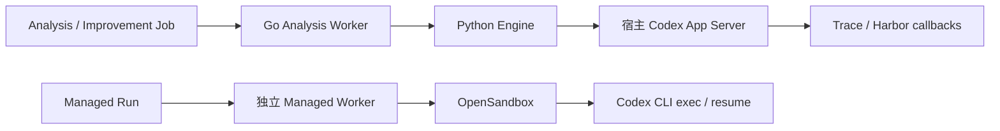
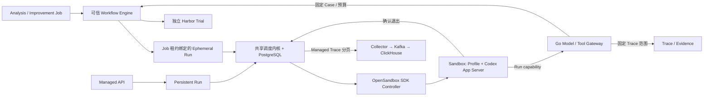

# ADR：三个 Profile 共用 Agent Harness 与 OpenSandbox

## 决策

Analysis、Improvement、Managed 使用同一个 Codex App Server 适配、OpenSandbox SDK 控制器和调度内核。Profile 提供版本、角色指令、Skill、Knowledge 引用、能力与 Session 策略。Go 授权模型和可信工具。Python Engine 只执行确定性工作流、验证结果和运行 Harbor。用户 Agent 与内部 Agent 均由 Sandbox 内的入口启动。

| 模块 | 责任 |
|---|---|
| Go `scheduler.go` | Worker 启停、轮询与唤醒、Claim 超时、退避、Heartbeat 和取消传播。业务保留自己的 Claim、Fencing、重试决策和计数。 |
| Go `analysis_workflow.go`、Python `analysis.py` / `improvement.py` | 固定调查范围、来源证据校验、独立 Case 与实验预算、候选冻结和结果持久化。 |
| Go `harness_workflow.go` | 私有 Job capability、一次性 Ephemeral Turn 绑定、按 Profile 和活租约授权工具。 |
| Go `managed_store.go` / `managed_reconcile.go` | Run 与 Sandbox 所有权、容量预留、持久操作意图和故障隔离。 |
| Python `managed/server.py` | OpenSandbox SDK、Provider 边界与错误分类、确认前台命令退出。 |
| Sandbox `runtime/codex.py` / `managed/entry.py` | Profile 装配、Thread Start/Resume、原生 Skill、动态工具、流式事件、结果与 checkpoint。 |
| Sandbox `managed/foreground.py` | Linux subreaper 验证 App Server 及其工具后代已退出，含脱离原进程组的工具。 |

统一 Harness 是为了让三个场景的协议、授权与隔离修复只落一处。保留 Workflow 是因为证据有效性、Case 指纹、实验预算、人工 Review 和未知副作用的恢复规则属于业务。Codex 负责推理与工具规划，Harbor 负责独立评测。保留已有业务 Job 表和基础设施 Run 表，分别表达业务进度与资源执行所有权，避免双重业务调度状态。没有引入新的队列表、Agent Registry 服务、微服务或通用插件框架。

## 生命周期

- Job 领取后由 Go 持有 Job lease。Engine 只拿到短期 Turn capability，不能选择其他 Job、租户、Profile 或 Sandbox。Analysis 的只读工具查固定 Trace 范围，Improvement 的工具进入同一 Engine 中为该 Job 注册的回调，仍由原 Workflow 校验候选路径、Case 和预算。
- Run 领取时独立发放 execution lease、fence、模型和工具 capability。内部 Session 绑定一次 Job lease，Job lease 失效后不再领取或调用工具，旧 Run 不会在新 Job lease 下重放。Engine receipt 保留既有幂等语义。内部执行记录隔离于公开 Managed API 与 Managed Trace 索引。
- 默认 Managed 容量之外预留 **一个**内部 Sandbox 槽和一个 Worker。Managed 本机上限两个，启用 Engine 后的整机 Sandbox 上限三个。模型租户预算仍共享。Admission 和模型预算使用租户行锁，持久 Sandbox 分配保留短容量事务。Provider 请求在事务外执行。
- 正常结果要等 App Server 报告匹配的 Turn 完成、所有命令结束、进程组退出、Linux 后代检查通过和 SDK 确认退出，Go 读完执行流后才提交。Persistent Session 保留 checkpoint 并可复用 Sandbox。Ephemeral Session 终态后进入删除，Provider 确认回收才释放容量。
- 取消、超时或未知命令结果撤销 capability，Run 进入 `STOPPING`。取消通过隔离旧 Sandbox 达到强制停止，运行时协议没有把通知送达当成停止证明。旧实例确认销毁后才提交取消/待审等终态。已发生的外部副作用不能撤销。未知创建和销毁继续沿原 Operation Intent 和 CAS 恢复。
- Trace 读取使用同一 Collector 数据面，分页、跨页工具 Span 和 ACK 重试保留。Analysis evidence 继续走原 Artifact 契约。Harbor 容器不进入用户 Session 或共享它的 checkpoint。

## 升级

1. 停止新任务，等待旧 Analysis、Improvement、Managed Run 完成或取消并隔离；导出需保留的 checkpoint。持久会话的下一 Turn 只在 Sandbox 使用新镜像后运行，因此先回收旧物理实例。
2. 构建新 Sandbox 镜像，成对部署 Go、SDK Adapter 和可信 Engine。007 增加可选 Profile 字段，旧 Managed Profile 自动保留既有 `sandbox-write` 权限。006 增加内部 Job 绑定和能力索引，历史 Job、Evidence、Artifact、Run、Review 行保留。
3. 将 `CATENA_MANAGED_CONTROL_URL` 指向 Sandbox 可达的专用 capability listener，`CATENA_CONTROL_URL` 指向可信 Engine 可达的 Go 控制入口。普通 Compose 在没有 Provider 配置时仍能读取历史数据，业务执行需要配置 OpenSandbox。
4. 本机复现见 [部署命令](../../deploy/managed/README.md)。当前支持可信单机 Docker。恶意多租户隔离、跨节点路由与高可用未验收。Engine receipt 与活跃工具回调要求同一可信 Engine 实例，滚动升级先排空。

## 验收

以 PR #6 的 `265876e` 建立基线，Go PostgreSQL race、Python 54 项、前端 38 项与浏览器 13 项通过。本轮验收记录和失败说明见下方报告。
